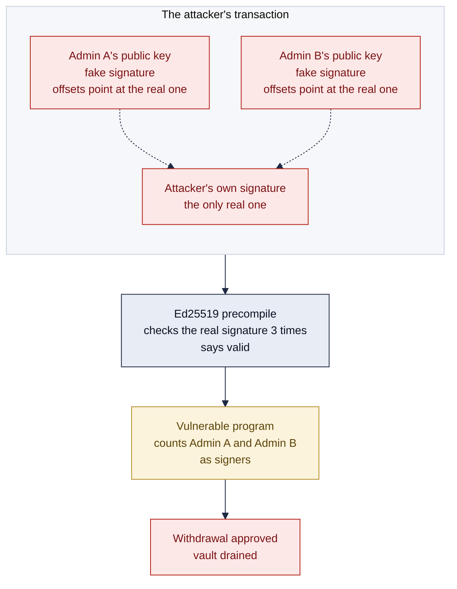
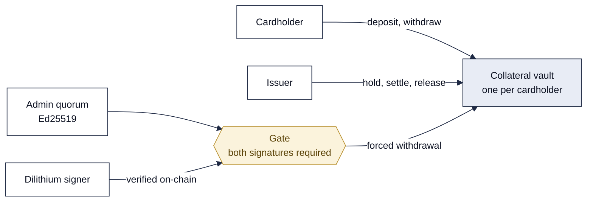
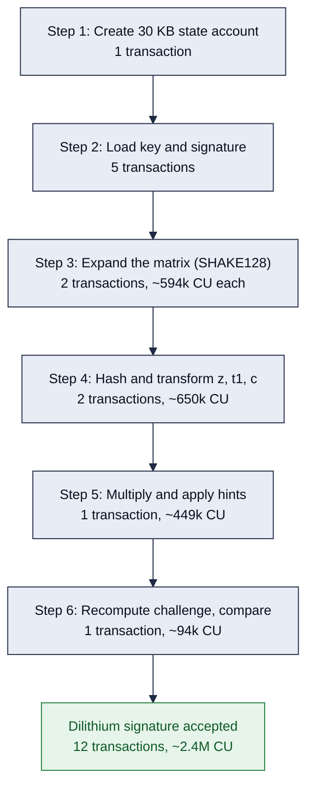

<p align="center">
  
</p>

**Quantum-safe collateral vaults for stablecoin cards. Built on Solana, with
NIST post-quantum signatures verified on-chain.**

## Inspiration

On August 28, 2026, Rain, one of the largest stablecoin card issuers, whose
Visa cards sit behind neobanks like Avici and Tria, lost about $1.1 million
from 2,682 customer vaults on Solana in roughly two and a half hours
([Verichains](https://blog.verichains.io/p/rain-hack-analysis-ed25519-signature),
[CoinDesk](https://www.coindesk.com/web3/2026/08/29/a-usd1-1-million-crypto-card-hack-crashed-a-neobank-s-token-49),
[Blockaid](https://blockaid.io/blog/11m-rain-ecosystem-exploit-how-onchain-monitoring-gives-stablecoin-card-issuers-fleet-level-coverage)).
The attacker held none of the admin keys that were supposed to guard those
vaults. Rain's program checked admin signatures through Solana's Ed25519
verification instruction and trusted the public keys in each entry without
checking that the entry's offsets pointed at its own data. One real signature
from a throwaway key, with the real admins' public keys pointed back at it,
passed as a full admin quorum. The attacker added itself as an admin on
victims' accounts and emptied them.

It makes us ask the question: how do you make a cryptographic approval
signature that can't be forged and can't be broken?

## Background

As quantum computing becomes an active threat to the cryptography we rely on,
the schemes behind every signature on every major blockchain will have to be
replaced. Ed25519, which signs every Solana transaction, and the ECDSA
signatures behind Bitcoin and Ethereum all rest on the same assumption: that
no one can recover a private key from a public key. Shor's algorithm on a
large enough quantum computer breaks that assumption outright, and on a
blockchain a forged key is the funds. NIST and the NSA's CNSA 2.0 guidance
treat the move to post-quantum signatures as a matter of when, with deadlines
for national-security systems in the early 2030s
([NSA](https://media.defense.gov/2022/Sep/07/2003071834/-1/-1/0/CSA_CNSA_2.0_ALGORITHMS_.PDF)).

In August 2024 NIST published the first finished post-quantum standards
([NIST](https://www.nist.gov/news-events/news/2024/08/nist-releases-first-3-finalized-post-quantum-encryption-standards)).
Its primary signature is Dilithium, standardized as ML-DSA in FIPS 204. It is
a lattice-based scheme built on the Learning With Errors problem, which no
known quantum algorithm solves efficiently. It is fast, its keys and
signatures are small enough to deploy everywhere, and it is the standard the
industry will converge on.

There was no implementation of Dilithium on Solana for verifying signatures.
The published verifiers overflow the Solana VM's 4096-byte stack frame as
written, so the standard that everything will move to could not run on the
chain where the Rain vaults live. I set out to change that: build the vault
that fixes the bug that cost Rain $1.1 million, and put Dilithium on Solana so
the next vault outlives the quantum computer. Argonath is named for the two
stone sentinels on the river in Tolkien's Middle-earth: two guards, one gate,
and you pass both or you do not pass.

## The problem Argonath solves

**How a stablecoin card works.** A stablecoin card, like the Visa and
Mastercard products from issuers such as Rain and Kast, lets you spend
stablecoins anywhere a card is accepted. When you deposit USDC into your card
account, the issuer locks it as collateral in an on-chain vault. When you buy
something, the issuer places a hold on part of that collateral, the card
network authorizes the purchase, and the issuer settles the charge to the
merchant and releases whatever was not spent. You keep the right to withdraw
anything not on hold.

**The weak point.** Behind that everyday flow there is an admin path. A small
group of the issuer's admins can force a withdrawal from a vault, for a
dispute, a stolen card, or a wind-down, and that path is guarded by their
signatures. It is the most valuable thing in the system, because one forged
admin approval moves everyone's collateral. It is exactly what the Rain
attacker forged.



**What Argonath changes.** Every admin action requires two signatures. The
first is Ed25519, the signature Solana already uses, verified correctly: every
entry must reference itself, and the admins sign a digest bound to the action,
the nonce, the expiry and the parameters, so an approval cannot be replayed or
redirected. The second is Dilithium, verified on-chain. The program rejects any
admin action that carries only one of the two, and disabling the Dilithium
requirement is itself an admin action, so compromised Ed25519 keys alone
cannot remove it.

The program is live on devnet as
[`41DLEct3Mu2ggxAKWbLNKVQimALYuNMFz8saTpKewVTa`](https://explorer.solana.com/address/41DLEct3Mu2ggxAKWbLNKVQimALYuNMFz8saTpKewVTa?cluster=devnet).
The full technical write-up is [`docs/writeup.md`](docs/writeup.md).

## What it does

- **Runs the card.** Cardholders open a vault per token, deposit and withdraw
  free collateral. The issuer places holds with an expiry, settles part or all
  of a hold to its own account, and releases the rest. Expired holds can be
  released by anyone. The issuer can pause its own actions; it can never
  block a cardholder's withdrawal.
- **Verifies what it counts.** Forced withdrawals and admin-set changes need
  an M-of-N Ed25519 quorum over a bound approval digest. Any precompile entry
  that does not point at itself is rejected before its public key is read.
- **Reproduces the Rain exploit.** A `vulnerable` build drops the one check.
  The same forged transaction drains that build and is rejected by the default
  build with `InvalidSignatureEntry`.
- **Verifies Dilithium on-chain.** A 1312-byte public key and 2420-byte
  signature stream into a 30 KB account and are verified in 12 transactions,
  about 2.4 million compute units in all, with every polynomial kept off the
  stack.
- **Requires both.** Once a Dilithium key is enrolled, every admin action must
  carry a finalized Dilithium approval over the exact digest the Ed25519 admins
  signed, under that key. Removing the key is gated the same way.
- **Upgrades in place.** A coordinator deployed before the Dilithium requirement existed is
  migrated with one instruction, no redeploy.

## Solana

Stablecoin cards settle on Solana because it clears a payment in under a
second for a fraction of a cent and USDC is native to it, which is why issuers
like Rain and Kast build there. It is also the chain with the most to gain
from Dilithium: every Solana signature is Ed25519, and the runtime has no
post-quantum primitive, so a verifier has to be built inside a program. Three
limits of the Solana VM shaped how.

- **Transaction size.** A transaction holds 1232 bytes. A Dilithium public key
  and signature are 3732 bytes together, so they are loaded into a state
  account over five transactions and verified from there.
- **Stack frame.** A program gets 4096 bytes of stack. The published Dilithium
  verifiers overflow it because they keep the 16 KB expanded matrix and the
  polynomial vectors on the stack. Argonath keeps all of that in a 30 KB
  zero-copy account, created by the client in one system instruction since a
  program can only grow an account by 10 KB per transaction, and works on it
  in place.
- **Compute budget.** A transaction gets 1.4 million compute units. SHA-256 is
  a syscall; Keccak is not, so Dilithium's SHAKE-based matrix expansion runs in
  software at about 74,000 compute units per polynomial. The verification is
  split into 12 transactions so the largest stays under 600,000.

## How I built it

### The program (Rust, Anchor)

One Anchor program, `collateral`, with four account types. `Coordinator` is
one per issuer: the issuer key, the admin set and threshold, a nonce, the
pause flag, the post-quantum mode and the enrolled post-quantum key.
`Collateral` is one per cardholder per token: deposited and held amounts.
`AuthHold` is one open card authorization with an amount and an expiry.
`MlDsaVerifyState` is a streamed Dilithium verification.



| Instruction | Who | Gate |
| --- | --- | --- |
| `init_coordinator`, `set_paused`, `migrate_coordinator` | issuer | issuer signature |
| `open_collateral`, `deposit`, `withdraw_free` | cardholder | owner signature; never paused |
| `authorize`, `settle`, `release` | issuer | issuer signature; holds auto-expire |
| `admin_withdraw`, `rotate_admins`, `set_pq_mode` | admin quorum | Ed25519 M-of-N, plus a Dilithium approval once a key is enrolled |
| `ml_dsa_open`, `ml_dsa_load`, `ml_dsa_expand`, `ml_dsa_prepare_hash`, `ml_dsa_prepare_polys`, `ml_dsa_row`, `ml_dsa_finalize` | anyone | builds a Dilithium `MlDsaVerifyState` for one digest |

### The Ed25519 quorum

Forced withdrawals and admin changes need an M-of-N Ed25519 quorum. The
verifier rejects any precompile entry that does not reference itself, which is
the Rain bug, then checks the message, the admin set, duplicates and the
threshold. What the admins sign is a digest bound to the action, the program,
the coordinator and its nonce, an expiry slot and the parameters, so an
approval cannot be replayed or redirected. A `vulnerable` build drops the one
check: `tests/exploit.ts` drains it with a forged quorum, and `tests/quorum.ts`
sends the identical transaction at the default build and watches it bounce.

### The Dilithium verifier

I wrote `crates/mldsa-verify`, a `no_std` implementation of FIPS 204
Algorithm 8 (ML-DSA.Verify) at the ML-DSA-44 level. Every function takes its
buffers by reference, so nothing larger than a SHAKE state lives on the stack.
On-chain, all working state lives in a 30 KB zero-copy account: the public key
and signature, the 16 expanded matrix polynomials in NTT form, the transformed
`z`, `t1` and `c`, and the packed `w1`. Each transaction does one bounded piece
of the algorithm and writes its result back.



Correctness rests on three independent implementations agreeing. The crate's
host tests verify signatures produced by the `fips204` Rust crate. The
on-chain tests verify signatures produced by noble's JavaScript `ml_dsa44`.
Tampering with one signature byte, one key byte, or the message is rejected at
finalize. `tests/mldsa.ts` regenerates `bench/mldsa-results.csv`.

### Requiring both signatures

The admins register a Dilithium public key with `set_pq_mode`. After that,
every admin action needs the Ed25519 quorum and a completed Dilithium
verification over the same digest, or it is rejected. Each approval is bound
to the coordinator's nonce, so it cannot be reused. Removing the key is itself
an admin action, so stolen Ed25519 keys alone cannot remove it.

### The authorizer (Node.js)

A reference issuer backend in `authorizer/`: a Fastify API that drives the
card lifecycle (authorize, settle, release, vault balances) and emits
webhooks, a `sign-approval` CLI that builds the off-chain M-of-N Ed25519
approval for a quorum-gated action, and a helper that signs with Dilithium and
streams the verification on-chain.

### Tests

51 on-chain tests on a local validator covering the vault and card lifecycle
(23), the Ed25519 quorum and the Rain forgery (9), the Dilithium verifier (3),
and the gate (16). Plus host tests for the Dilithium verifier against the
`fips204` reference and for the quorum parser, and a cargo-fuzz target for the
parser.

## On devnet

Program
[`41DLEct3Mu2ggxAKWbLNKVQimALYuNMFz8saTpKewVTa`](https://explorer.solana.com/address/41DLEct3Mu2ggxAKWbLNKVQimALYuNMFz8saTpKewVTa?cluster=devnet)
with its IDL published on-chain, so Explorer decodes every instruction by
name.

On devnet the coordinator
[enrols a Dilithium key](https://explorer.solana.com/tx/2rraaomGMQL56sCGDsvQt1q5R48vrqv7cB7mqwfUtYG8AS5paEBVPBbNEw1WNBd78iUkzwpebHxPLLxpg7FJTzr8?cluster=devnet),
a Dilithium signature is verified across 12 transactions ending in
[`ml_dsa_finalize`](https://explorer.solana.com/tx/3pFYKorLyowSBK8DrxY7vqCdTBCbf6dux9qTNvB9foTD6G8RDx4TzBYB4CbqS3ZSomeRyBPWTALyFiWCPJZX5NUr?cluster=devnet),
the Ed25519-only withdrawal is
[rejected with `PqApprovalRequired`](https://explorer.solana.com/tx/5nPtQSJfMdnF6PpXkt3G2SMyVUiaUYeEvcze8UeiDR7qkoLAhpaM21seqFY36yui2oKCphx5PfHspTtp35cPneVm?cluster=devnet),
and the same withdrawal with the Dilithium approval attached is
[accepted](https://explorer.solana.com/tx/4Q5jS37nzAENhR9HGXHnz6YLkCb9hBoMDUSDPH5vjLyoF9qmWYb6QYmHXqVJaDXPc6w98EVJpcon8PXdKv7k9HuD?cluster=devnet).

## Build and test

Requires Rust, Solana CLI 4.3.2 (pinned in `Anchor.toml`), Anchor 0.31.1,
Node.js and Yarn.

Build the program and run the 51 on-chain tests on a local validator, about
two minutes. The one pending test is the exploit, which only runs against the
vulnerable build.

```
yarn install
anchor build
anchor test
```

Host tests, no validator needed: the Dilithium verifier against `fips204`
signatures, and the quorum parser against random bytes.

```
cargo test -p mldsa-verify
cargo test -p collateral --lib
```

Run the Rain exploit against the vulnerable build, then the same transaction
against the default build. The first drains the vault; the second is rejected.

```
anchor build -- --features vulnerable
VULN=1 anchor test --skip-build
anchor build
anchor test --skip-build
```

## Deploy to devnet

With a wallet holding a few SOL (rent for the 460 KB program is about 3 SOL):

```
solana config set --url devnet
anchor keys sync
anchor build
anchor deploy --provider.cluster devnet
anchor idl init -f target/idl/collateral.json <PROGRAM_ID> --provider.cluster devnet
```
